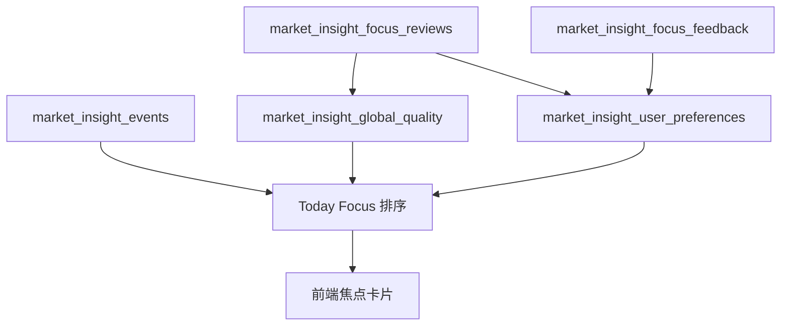

# 火眼金睛排序与质量评分设计

## 目标

火眼金睛的目标不是把所有市场事件都展示给用户，而是在大量事件中选出最值得优先确认的焦点。用户不需要理解内部打分细节，前端只需要用自然语言说明“为什么先看”。本文档用于后期维护排序、反馈、盘后验证和质量评分逻辑。

## 分层原则

### 1. 市场事实层

市场事实是不区分用户的客观数据，包括：

- `market_insight_events`：盘中生成的市场洞察事件。
- `market_insight_focus_reviews`：盘后对具体焦点的验证结果。
- `market_insight_global_quality`：从历史盘后验证聚合出的全局质量评分。

这些数据不带用户偏好，不应该因为某个用户的点击而改变。

### 2. 用户个性化层

个性化只影响排序，不改变市场事实：

- `market_insight_focus_feedback`：用户对某个具体焦点的反馈。
- `market_insight_user_preferences`：由用户反馈和相关盘后验证聚合出的个人偏好画像。

同一个事件，A 用户和 B 用户看到的客观验证结果应一致，但排序可以不同。

### 3. 展示解释层

展示层不暴露复杂公式。前端可以展示：

- “同类焦点历史验证表现较好”
- “结合您过往反馈，这类焦点更符合您的关注偏好”
- “该焦点客观分较高，但同类内容曾被您多次降权”

不建议让普通用户理解 `event_type_weight`、`preference_weight`、`global_quality_weight` 等内部概念。

## Today Focus 排序结构

当前焦点排序分可以理解为：

```text
attention_score =
  objective_event_score
  + user_relevance_weight
  + feedback_weight
  + preference_weight
  + global_quality_weight
```

其中：

- `objective_event_score`：事件自身重要性，由置信度、事件类型、严重程度、实时性和主体类型组成。
- `user_relevance_weight`：是否命中用户真实持仓、T+0 模拟仓或自选股。
- `feedback_weight`：用户对这个具体焦点是否已点过“有价值 / 忽略 / 误报”。
- `preference_weight`：用户长期偏好画像产生的个性化权重，限制在 `[-5, 5]`。
- `global_quality_weight`：同类事件历史盘后验证质量产生的全局权重，限制在 `[-4, 4]`。

`preference_weight` 和 `global_quality_weight` 都是辅助信号，不能压过事件自身的重要性。

## 用户偏好画像

集合：`market_insight_user_preferences`

维度：

- `event_type`
- `category`
- `subject_type`

计数字段：

- `valuable_count`：用户点击“有价值”时增加。
- `ignore_count`：用户点击“忽略”时增加。
- `false_positive_count`：用户点击“误报”时增加。
- `confirmed_count`：用户反馈过的焦点，盘后验证为 `confirmed` 时增加。
- `faded_count`：用户反馈过的焦点，盘后验证为 `faded` 时增加。

评分公式：

```python
score = (
    valuable_count * 2.0
    - ignore_count * 1.0
    - false_positive_count * 3.0
    + confirmed_count * 1.0
    - faded_count * 1.0
)
```

注意：盘后验证本身是全局事实，但只有用户曾经反馈过该焦点时，验证结果才会进入该用户的个人画像。

## 全局事件质量评分

集合：`market_insight_global_quality`

数据来源：`market_insight_focus_reviews`

维度：

- `event_type`
- `category`
- `subject_type`

统计字段：

- `confirmed_count`
- `faded_count`
- `unconfirmed_count`
- `insufficient_data_count`
- `reviewed_count`
- `decisive_count`
- `confirmation_rate`
- `fade_rate`
- `score`
- `weight`

设计要点：

- 只用 `confirmed` 和 `faded` 计算 `confirmation_rate`，因为它们是明确结论。
- `unconfirmed` 和 `insufficient_data` 计入覆盖度观察，但不直接作为正负质量判断。
- 当 `decisive_count` 太少时，`weight` 为 0，避免样本太少造成误导。
- `weight` 限制在 `[-4, 4]`，只作为轻量全局纠偏。

## 数据流



## API

### 质量评分

- `GET /market-insights/quality`
  - 查询全局质量评分。
  - 可选参数：`dimension=event_type|category|subject_type`。

- `POST /market-insights/quality/refresh`
  - 手动从 `market_insight_focus_reviews` 重建全局质量评分。

### 盘后验证

- `POST /market-insights/focus/review`
  - 生成或更新 `market_insight_focus_reviews`。
  - 同步刷新 `market_insight_global_quality`。
  - 对已反馈该焦点的用户，更新个人画像中的 `confirmed_count` 或 `faded_count`。

## 重算工具

当评分公式、维度权重或历史数据修复后，需要从历史反馈重新生成用户画像，避免旧增量结果残留。

脚本：

```bash
python tools/rebuild_market_insight_user_preferences.py --dry-run
python tools/rebuild_market_insight_user_preferences.py --apply
python tools/rebuild_market_insight_user_preferences.py --user-id u1 --apply
```

规则：

- 数据来源是 `market_insight_focus_feedback` 和 `market_insight_focus_reviews`。
- `--dry-run` 只计算结果，不写入 MongoDB。
- `--apply` 会先删除目标范围内旧的 `market_insight_user_preferences`，再写入重算结果。
- 指定 `--user-id` 时，只重建该用户画像；不指定时重建全部用户画像。
- 重算不依赖 feedback 文档中的 `preference_review_status` 缓存字段，而是直接读取当前 review 结果。

## 维护建议

- 调整权重时，优先改限制范围和维度权重，不要直接放大单个信号。
- 如果用户反馈和全局质量出现冲突，个人偏好只影响个人排序，全局质量只做轻量纠偏。
- 如果未来要做运营看板，应优先读取 `market_insight_global_quality`，不要直接扫描所有 `focus_reviews`。
- 如果评分公式变更，应先用 `--dry-run` 检查重算结果，再用 `--apply` 写入。

## 测试覆盖

相关单测位于：

- `tests/unit/test_market_insight_engine.py`
- `tests/unit/test_market_insights_router.py`

重点覆盖：

- 用户反馈更新画像。
- 盘后验证回写已反馈用户画像。
- 偏好画像重算工具。
- 全局质量评分聚合。
- 全局质量权重影响焦点排序。
- 质量评分查询和刷新 API。
