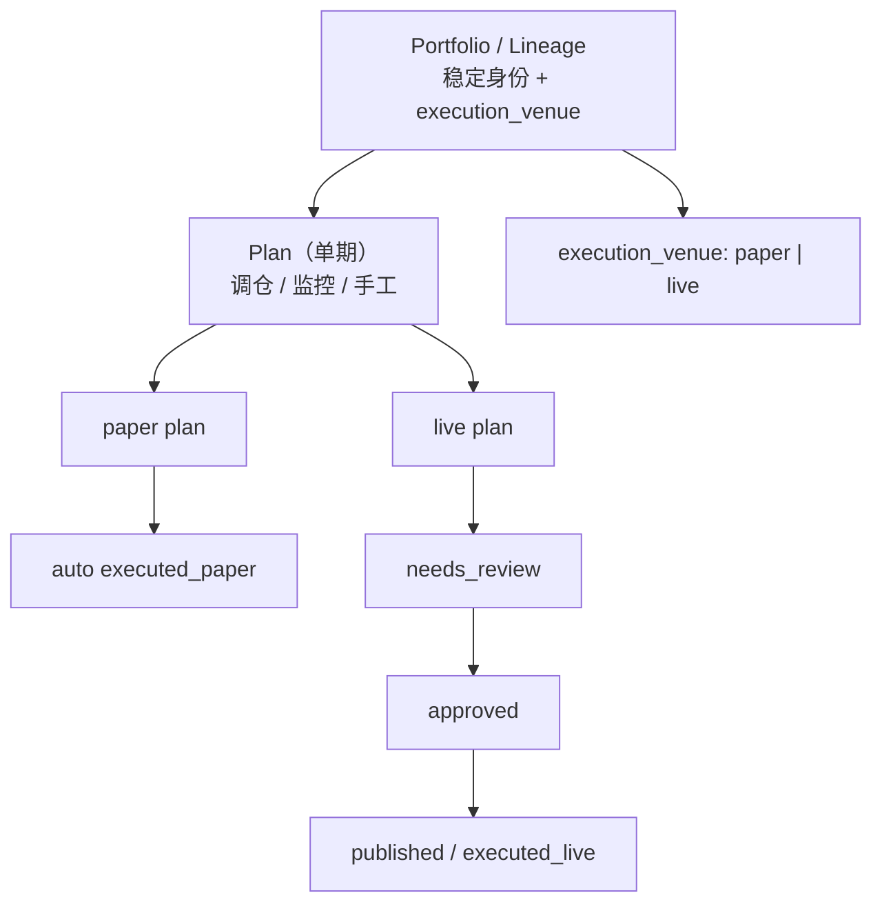

# Portfolio Domain Model（组合领域模型）

> 本文档收敛 **Portfolio / Lineage / Plan / Execution / Approval** 的边界与字段归属，
> 作为 `/portfolios` 轻量化、paper 自动执行、以及 `execution_venue` 物化改造的
> 设计依据。与 [portfolio_lifecycle.md](./portfolio_lifecycle.md) 互补：后者描述
> 运行时状态来源与 API 口径，本文档描述**概念分层与字段裁剪**。

---

## 1. 概念分层



| 层 | 职责 | 权威存储 | 关键标识 |
|---|---|---|---|
| **Portfolio / Lineage** | 用户选择的组合实例；同一策略参数下的长期血缘 | `portfolio_lineage_controls`（扩展 summary + `execution_venue`） | `(user_id, strategy_template_id, params_hash)` |
| **Plan** | 某一 `base_date` 的调仓/监控/手工记录 | `portfolio_trade_plans` | `plan_id` |
| **Execution Venue** | 组合最终走纸面还是实盘通道 | **Lineage 层物化** `execution_venue`；过渡期由 `trade_signals.mode=live` 回填 | `paper` / `live` |
| **Approval Policy** | 单期计划是否需人工审批 | Plan 层（live 走 `needs_review`；paper 默认自动） | `status` + `paper_execution_mode`（legacy） |
| **Execution State** | 计划生命周期 | Plan 层 `status` | `needs_review` → `approved` → `executed_*` |

---

## 2. 字段归属与裁剪（Field Audit）

| 字段 | 归属层 | 保留 / 弱化 / 迁移 | 说明 |
|---|---|---|---|
| `execution_venue` | **Lineage** | **物化**于 `portfolio_lineage_controls` | 权威来源；`live` 在首次 publish live signals 时写入；旧数据用 `trade_signals.mode=live` 回填 |
| `latest_plan_id` / `first_base_date` / `last_base_date` / `plan_count` | **Lineage** | 物化（denormalized） | 列表展示用；由 plan 聚合或 backfill 同步 |
| `paused` / `excluded_symbols` | **Lineage** | 保留 | 自动调仓控制，已在 `portfolio_lineage_controls` |
| `securities_account_id` | **Lineage**（live） | 保留 | live 血缘绑定的券商账户 |
| `paper_execution_mode` | **Plan** | **弱化** | 仅 plan 详情；paper 默认 `auto_shadow`；`manual_review` 仅 legacy 显式配置 |
| `status` | **Plan** | 保留 | `needs_review` / `approved` / `executed_paper` / `executed_live` / … |
| `executable` / `non_executable_reason` | **Plan** | 保留 | 单期是否可执行及原因 |
| `capital_basis` | **Plan** | 保留 | `initial_capital` / `account_equity` / `paper_lineage_reconstruction` 等 |
| `trading_enabled` | **Plan（monitor）** | 保留 | 监控日是否允许交易动作；与账户级 `live_trading_enabled` 不同 |
| `live_trading_enabled` | **Securities Account** | 保留 | 账户是否允许发 live 单 |
| `paper_snapshot_date` / `paper_holding_count` / `paper_equity` | **详情摘要** | **迁出列表** | 由 `GET /plans/{plan_id}/portfolio-summary` 延迟加载 |

### `/portfolios` 列表契约（轻量）

**应返回：** 身份、`execution_venue`、最新 plan 元数据、参数摘要、`paused` / `excluded_symbols`、live 账户 id。

**不应返回：** `paper_snapshot`、`paper_holding_count`、`paper_equity`、`paper_execution_mode`（改从 portfolio-summary 或 plan detail 读取）。

---

## 3. Paper vs Live 审批生命周期

### Paper（默认）

- 调仓日 plan 生成后，paper-only 血缘 **自动批准**（`auto_shadow`）。
- 次日开盘价走 `executed_paper` 纸面模拟路径。
- **不需要**人工 approve 按钮；`paper_execution_mode` 对用户不可见（除 legacy 配置）。

### Live（保留人工审批）

- 调仓日 plan 进入 `needs_review`。
- 人工 approve 后方可 `publish-live-signals`。
- Publish 成功时将 lineage `execution_venue` 置为 `live` 并记录 `securities_account_id`。

### `paper_execution_mode` 收敛

| 值 | 语义 | 状态 |
|---|---|---|
| `auto_shadow` | Paper 调仓自动批准并 shadow 执行 | **默认** |
| `manual_review` | Paper 也走人工门 | **Legacy**，仅 `params_snapshot.paper_execution_mode` 显式配置时生效 |

不再根据「lineage 曾有 live 成交」推断 `manual_review`。

---

## 4. `execution_venue` 物化设计

### 权威来源

`portfolio_lineage_controls.execution_venue`：

- 文档主键：`(user_id, strategy_template_id, params_hash)`（与 pause/exclusion 同文档）。
- `paper`：默认；仅 paper 活动。
- `live`：首次 `publish-live-signals` 写入；不可逆（同一血缘不会回到纯 paper 列表语义）。

### 同步时机

1. **Plan 生成**（`stock-scoring-system` worker）：upsert summary 字段（日期范围、plan_count、latest_plan_id 等）；venue 保持已有值或 `paper`。
2. **Live publish**（`quantFinance` API）：`execution_venue=live` + `securities_account_id`。
3. **Backfill**（`tools/backfill_portfolio_lineage_state.py`）：历史数据用 `trade_signals.mode=live` 回填 venue 与 summary。

### 过渡期读路径

```text
execution_venue =
  lineage_control.execution_venue
  ?? (exists live trade_signals for lineage ? 'live' : 'paper')
```

与 [portfolio_lifecycle.md §3.1](./portfolio_lifecycle.md) 判据一致；物化后列表不再逐 lineage 扫 executions / paper snapshots。

---

## 5. API 变更摘要

| 方法 | 路径 | 变更 |
|---|---|---|
| GET | `/portfolio-plans/portfolios` | 轻量列表；移除 paper 摘要字段 |
| GET | `/portfolio-plans/plans/{plan_id}/portfolio-summary` | **新增**；纸面快照、持仓数、权益、`paper_execution_mode` |
| GET | `/portfolio-plans/live-portfolios` | 过滤轻量列表中 `execution_venue=live` |

---

## 6. 实施顺序（本计划）

1. 本文档 + field audit（本文件 §2–§3）。
2. Paper 默认 `auto_shadow`；弱化 `manual_review`。
3. `portfolio_lineage_controls` 物化 `execution_venue` + summary；backfill 工具。
4. `/portfolios` 轻量化 + `portfolio-summary` 端点。
5. 前端：列表不依赖重摘要；详情选中后加载 summary。

---

## 7. 与 portfolio_lifecycle.md 的对齐

| 话题 | portfolio_lifecycle.md（原） | 本模型（更新后） |
|---|---|---|
| `execution_venue` | 派生、不入库 | **物化**于 lineage controls；读时 fallback 到 signals |
| Live 判据 | `trade_signals.mode=live` | 不变；用于 backfill 与 fallback |
| 首发 / 替补 / 对账 | 不变 | 仍在 plan 级 API（bench / reconcile） |

`portfolio_lifecycle.md` §2 中「组合级派生字段，不入库」在物化落地后应以本文档为准。
