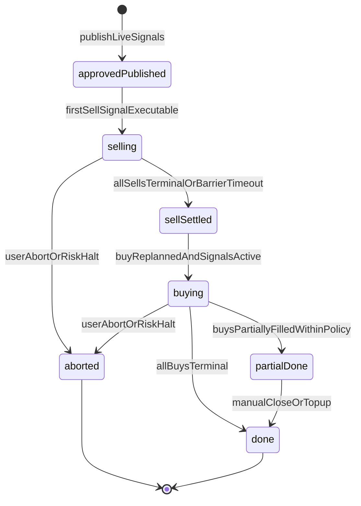
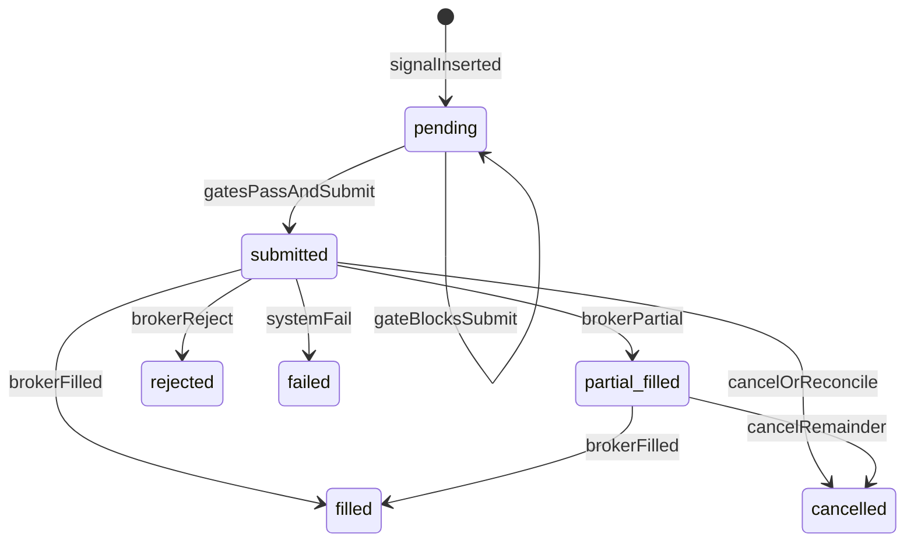
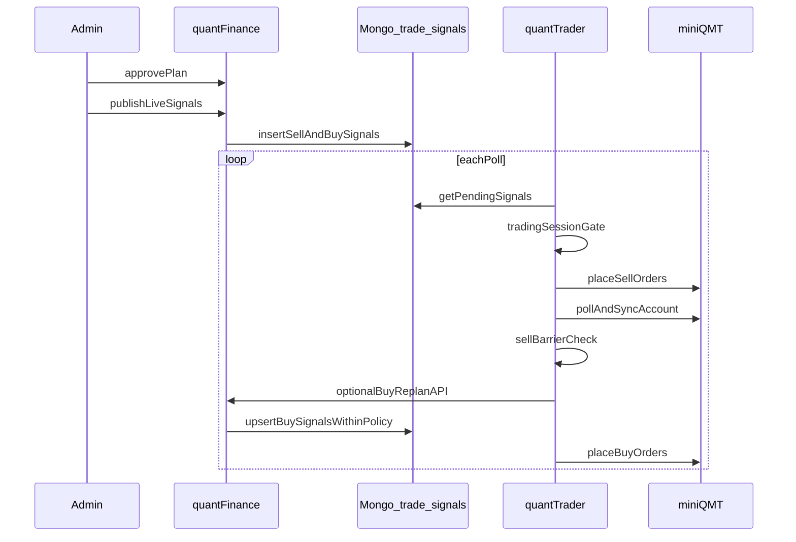

# 稳定调仓执行设计（两阶段卖 → 屏障 → 买 + 预授权自动重算买单）

本文档描述在现有「组合计划 → `trade_signals` → `quantTrader` → miniQMT」链路上，为提升**可预期性**与**资金约束下的正确性**而提出的执行层增强方案。与最小可执行信号契约的关系见 [live_trade_signals.md](./live_trade_signals.md)。

---

## 1. 背景与现状问题

以下结论均基于当前仓库实现，便于评审与落地时对照代码。

### 1.1 无交易时段闸门

`quantTrader` 主循环在每次轮询中拉取待处理信号后直接 `_handle_signal` 报单；只要进程在运行，**不区分**是否在连续竞价等可交易时段（见 `quantTrader/src/quant_trader/trader_loop.py` 中 `run_forever`：拉取 `get_pending_signals` 后依次处理卖、买）。

**风险**：非交易时段或隔夜误触发时，可能产生不合预期的挂单/拒单/状态抖动。

### 1.2 `valid_until` 与真实可执行窗口错位

契约中 `valid_until` 表示「首轮执行窗口过期」（见 [live_trade_signals.md](./live_trade_signals.md) 对 `valid_until` 的说明）。当前实现中 `valid_until = 发布时刻 + 10 分钟`（`services/live_trade_signals.py` 中 `valid_until=now + timedelta(minutes=10)`，硬编码常量），锚定在**计划发布时刻**。而实际最早可执行时间通常为**下一交易日开盘**，因此隔夜发布的信号在次日开盘前早已过期，出现「逻辑上尚未可执行，但已过期」「窗口与券商可接受时段不一致」的问题。§5.2 的 `PORTFOLIO_SIGNAL_VALID_TTL_SECONDS` 即对应这一默认 10 分钟常量。

### 1.3 卖出阶段不是「硬屏障」

当前实现已在**同一轮询周期内**做顺序处理：先处理 `execution_phase == sell` 的信号，再 `poll_execution_status`、再 `sync_account`，最后处理买信号；买单通过 `_passes_buy_cash_gate` 用**刷新后的** `available_cash` 做门控（见 `trader_loop.py` 中卖/买分段与 `_passes_buy_cash_gate`）。

**缺口**：并未要求「该计划下**全部**卖单到达终态」后才允许买；若卖单仍在 `submitted` / `partial_filled`，同一轮内仍可能因现金已部分释放而通过门控，或长期依赖 `waiting_for_cash` 的**重试式**衔接，行为对运营不够直观，也难与「调仓日」语义对齐。

### 1.4 买单未按真实成交与账户状态重算

买单的 `size` / 限价相关字段在发布时即固化；现金门控仅比较「估算金额 vs 当前可用现金」，**不会在屏障后**按实际卖出回款、滑点、部分成交等重新计算目标仓位或数量（`_estimated_signal_amount` 基于信号上的价格字段估算）。

**后果**：计划编制时往往假设「理想卖出后现金」；实盘部分卖出失败或价格偏离时，买单仍按原数量/价格意图执行，需人工依赖 **gap-fill（`plan_topup`）** 等补救路径，无法从执行模型上一次性闭环。

### 1.5 与现有能力的关系

- **价格保护**：已有 `reference_price`、`max_slippage_bps`、`price_floor` / `price_ceiling`、`effective_limit_price`；这解决的是**无界市价**风险，**不保证成交**。
- **Gap-fill**：`POST .../replan-remainder`（`source=plan_topup`）在「不重新选股」前提下补缺口，见 [live_trade_signals.md](./live_trade_signals.md)；本文档的「买阶段重算」与之可最终统一为同一套「在边界内重算可执行单」引擎（见 Phase 4）。

---

## 2. 设计原则

1. **发布 ≠ 可执行**：`publish-live-signals` 产出的是带风险审计的意图；是否向券商报单由 **时段闸门**、**相位屏障**、**valid 窗口** 共同决定。
2. **两阶段调仓**：**sell → barrier → buy**。屏障语义由产品定义，默认推荐：**同一 `plan_id` 下所有卖意图到达终态**后再进入买阶段（可配置超时与降级策略）。
3. **预授权自动重算买单**：在计划 **approve** 时固化一套 **replan 边界**（标的集合、总预算、单票上限、价格偏离、最小现金留存等）；在 `sell_settled` 且账户刷新后，由系统在边界内**自动**重算买单并写入新信号（或覆盖待定买单），**无需**人工二次 approve，除非触发「越界 / 超时 / 需要新风控确认」等例外分支。
4. **可观测与可回滚**：计划级状态、屏障原因、重算前后 diff 必须落审计日志；功能由配置开关控制，默认关闭以便灰度。

---

## 3. 状态机与时序

### 3.1 计划级状态机（提议）

描述单个 `plan_id` 在「已批准且已发布实盘信号」之后的执行编排状态（与 Mongo 中 `portfolio_trade_plans` 等业务状态并存，需明确字段存放位置，见 §4.2）。



**状态含义（简表）**

| 状态（建议落库值） | 说明 |
|------|------|
| `approved_published` | 计划已批准且已发布信号（可与现有 `approved` + 存在 `plan_id` 信号对齐；与状态图节点 `approvedPublished` 对应） |
| `selling` | 执行层已进入卖阶段，允许提交卖单（受时段闸门约束） |
| `sell_settled` | 卖阶段屏障已满足（见 §3.3），账户已刷新，可进入买阶段重算（与状态图节点 `sellSettled` 对应） |
| `buying` | 买信号已生成或解冻，执行层可提交买单 |
| `done` | 买阶段在策略定义下视为完成（含允许的部分成交策略） |
| `partial_done` | 可选：部分成交且不再自动追单，等待 `plan_topup` 或人工（与状态图节点 `partialDone` 对应） |
| `aborted` | 风控/人工中止，后续信号不再执行 |

### 3.2 信号级生命周期（现有 + 闸门）

信号状态仍遵循现有约定（见 [live_trade_signals.md](./live_trade_signals.md)）：

`pending → submitted → partial_filled → filled`，以及 `rejected` / `cancelled` / `failed`。

**叠加约束（提议）**：

- 在 `pending` 时，若当前时间 `< activate_after` 或不在允许交易时段，则**不提交**券商，保持 `pending`（或单独子状态 `scheduled`，若未来拆分）。
- 若存在 `phase_barrier`，在屏障未清除前，买信号**不得**进入提交路径。



### 3.3 端到端时序（提议）



说明：`buy_phase_replan` 可实现在 **Backend**（推荐：集中审计、复用定价与风控）或 **Trader**（需额外 API 与鉴权）；默认推荐 Backend 异步任务或「屏障满足后单次 RPC」模式，具体在 Phase 3 实现时选定。

### 3.4 实现决策：派生状态 + 屏障精确定义（Phase 1 固化）

**(D1) `execution_phase_state` 采用「派生 + 事件时间戳落库」，不作为权威可变状态存储。**

- 计划级阶段状态由该 `plan_id` 下所有 live signal 的实时状态**派生计算**（函数 `derive_execution_phase_state`），避免「信号已终态但 plan 字段没回写」造成的漂移。
- 只**落库不会漂移的事件事实**：`sell_settled_at`（屏障首次满足时间）、已有的 `live_signals_published_at`。
- 计划详情接口可返回派生出的 `execution_phase_state`，但它是计算结果，不是需要维护一致性的存储字段。

**(D2) 卖出屏障（`plan_sells_terminal`）的精确定义：**

> 对某 `plan_id`，当其下**所有** `mode=live` 且 `execution_phase=sell` 的 live signal 都处于**终态**时，屏障满足。

- 终态集合：`filled` / `cancelled` / `canceled` / `rejected` / `failed` / `partial_cancelled`（复用 `TERMINAL_SIGNAL_STATUSES`）。
- **不区分来源**：原始发布、`plan_topup`、`manual_reprice` 的卖单都计入。
- **未成交也算满足**：卖单 `cancelled` / `rejected` 同样视为该卖意图已结束（屏障是「不再有在途卖单」，不是「卖出全部成交」）。
- **纯买计划**（无任何 sell signal）：屏障 trivially 满足。
- 该定义同时驱动 §3.1 的 `selling → sell_settled` 推进与 buy signal 的 `phase_barrier` 放行（放行强制在 Phase 2）。

**(D3) 阶段范围声明：**

- **Phase 1**：仅写入 buy signal 的 `phase_barrier` 字段、提供 `derive_execution_phase_state`/屏障判定函数、落库 `sell_settled_at`（当可判定时）。`phase_barrier` 字段此阶段**写入但不强制**（trader 仍按现有同轮 sell→buy 顺序执行，无回归）。
- **Phase 2**：trader/后端开始**强制**屏障，未满足则买单保持 `pending`。
- `partial_done`：**Phase 1 不产生**，留待买阶段策略（Phase 3）定义。

---

## 4. 字段定义

### 4.1 `trade_signals` 文档（新增 / 扩展）

以下字段为**设计提议**；落地时需更新 [live_trade_signals.md](./live_trade_signals.md) 中的 Minimum Fields 与校验器 `LiveTradeSignal`。

| 字段 | 类型 | 默认值 | 写入方 | 读取方 | 说明与示例 |
|------|------|--------|--------|--------|------------|
| `activate_after` | `string` (ISO8601) 或 `Date` | 无 | Backend 发布时 | Trader | 最早允许向券商提交的时间；可与「调仓日开盘」对齐。例：`2026-06-19T01:30:00+08:00`（若采用集合竞价前不下单策略则再后移）。 |
| `executable_session` | `string` | 无 | Backend | Trader | 可选：枚举如 `CN_A_continuous`；与配置中的会话表解析一致。 |
| `phase_barrier` | `object` | 无 | Backend | Trader | 买单上携带：`{ "type": "plan_sells_terminal", "plan_id": "..." }`。屏障清除前禁止提交买单。 |
| `replan_policy` | `object` | 无 | Backend（approve 快照） | Backend 重算 | 预授权边界，结构见 §4.3。可冗余写入每条买信号便于审计，或以 `plan_id` 查计划。 |
| `replan_generation` | `int` | `0` | Backend | Trader / 审计 | 买阶段重算代数；屏障后每重算一次 +1。 |
| `supersedes_order_ids` | `array[string]` | `[]` | Backend | 审计 | 本次重算逻辑上替代的 `order_id` 列表（原买单标记 `cancelled` 或 `superseded` 策略在实现时定义）。 |

**与现有字段关系（不变更语义，仅对齐使用方式）**

| 现有字段 | 与本设计关系 |
|----------|----------------|
| `execution_phase` | 仍为 `sell` / `buy`；屏障只作用于 `buy`。 |
| `execution_priority` | 同相位内排序不变。 |
| `valid_until` | 建议改为相对 **`activate_after` 或会话收盘** 的窗口终点，避免「发布夜即过期」。 |
| `reference_price` / `max_slippage_bps` / `price_floor` / `price_ceiling` / `effective_limit_price` | 重算买单时重新解析行情后重新计算保护价，仍遵守现有公式契约。 |
| `order_id` / 幂等索引 | 重算后的新买单必须使用新 `order_id`（或明确版本的 deterministic id），避免与旧单冲突。 |

### 4.2 `portfolio_trade_plans`（或等价集合）扩展

存储策略见 §3.4 (D1)：`execution_phase_state` 为**派生值**（不落库为权威状态），其余为**落库事件**。

| 字段 | 类型 | 存储 | 说明 |
|------|------|------|------|
| `execution_phase_state` | `string` | 派生（不落库） | 由 `derive_execution_phase_state` 实时计算，值域见 §3.1。 |
| `sell_settled_at` | `datetime` | 落库事件 | 卖出屏障首次满足时间；幂等写入，不回退。 |
| `buy_replan_rules` | `object` | 落库（Phase 3） | approve 时固化的预授权规则（与 §4.3 一致或为其子集指针）。 |
| `last_buy_replan_at` | `datetime` | 落库（Phase 3） | 上次买阶段重算时间。 |
| `last_buy_replan_summary` | `object` | 落库（Phase 3） | 可选：重算前后 notional、现金、逐标的 diff 摘要。 |

审计：继续沿用 `portfolio_plan_operation_logs`（与 `plan_topup` 一致思想），新增事件类型如 `buy_phase_replan`。

### 4.3 `replan_policy` / `buy_replan_rules` 建议结构

```json
{
  "allow_new_symbols": false,
  "max_total_buy_notional": 1500000.0,
  "max_per_symbol_notional": 300000.0,
  "min_cash_reserve": 10000.0,
  "max_price_deviation_bps_vs_reference": 200,
  "max_shares_deviation_vs_original_pct": 15,
  "on_out_of_bounds": "halt_and_notify"
}
```

| 键 | 含义 |
|----|------|
| `allow_new_symbols` | 是否允许买阶段出现计划外新标的；调仓场景建议默认 `false`。 |
| `max_total_buy_notional` | 相对原计划或当前现金的买上限（实现时二选一并文档化）。 |
| `max_per_symbol_notional` | 单票名义金额上限。 |
| `min_cash_reserve` | 保留最低现金，重算后总买额 ≤ 可用现金 − 保留。 |
| `max_price_deviation_bps_vs_reference` | 重算用参考价相对原始 `reference_price` 的最大偏离；超出则 `halt` 或收窄数量。 |
| `max_shares_deviation_vs_original_pct` | 相对原发布买单 `size` 的最大偏离百分比。 |
| `on_out_of_bounds` | `halt_and_notify` / `clip_to_bounds` / `require_manual_approve` 等枚举。 |

---

## 5. 配置项

### 5.1 现有约定（保持）

`quantTrader` 从 `config.json` 的 `execution` 段读取数值，环境变量 **`QUANT_TRADER_*` 优先**覆盖 JSON。已有示例（见 `quantTrader/src/quant_trader/config.py`）：

| 键（JSON） | 环境变量 | 默认 | 含义 |
|------------|-----------|------|------|
| `buy_order_timeout_seconds` | `QUANT_TRADER_BUY_ORDER_TIMEOUT_SECONDS` | `3600` | 买单相关超时（现有语义保持） |
| `cancel_retry_grace_seconds` | `QUANT_TRADER_CANCEL_RETRY_GRACE_SECONDS` | `15` | 撤单重试宽限 |
| `cancel_retry_interval_seconds` | `QUANT_TRADER_CANCEL_RETRY_INTERVAL_SECONDS` | `25` | 撤单重试间隔 |
| `poll_interval` | `TRADER_POLL_INTERVAL` | `1.0` | 主循环轮询间隔（秒） |

### 5.2 提议新增（仅本文档定义，实现时照此命名或调整并回写本文档）

**Trader / 执行闸门**

| 环境变量 / JSON | 默认 | 作用域 | 含义 |
|-----------------|------|--------|------|
| `QUANT_TRADER_TRADING_SESSIONS` | miniQMT 默认 `CN_A`；其他 broker 为空 | Trader | JSON 或约定 DSL，描述允许提交订单的本地时间窗口。`CN_A` 表示工作日 `09:25-11:30,13:00-15:00`；空表示不做时段闸门。 |
| `QUANT_TRADER_REJECT_SIGNALS_OUTSIDE_SESSION` | `false` | Trader | `true` 时非时段内不单保持 pending，还可选择打 `last_error` 便于监控（实现细节待定）。 |
| `QUANT_TRADER_USE_ACTIVATE_AFTER` | `true` | Trader | 是否尊重信号上的 `activate_after`。 |

**屏障与降级**

| 环境变量 / JSON | 默认 | 含义 |
|-----------------|------|------|
| `QUANT_TRADER_SELL_BARRIER_MODE` | `off` | `off`（现状） / `plan_terminal`（同 plan 卖单全终态） / `plan_terminal_or_timeout`。 |
| `QUANT_TRADER_SELL_BARRIER_TIMEOUT_SECONDS` | `0` | `0` 表示不超时；非零时超时触发 `on_barrier_timeout`。 |
| `QUANT_TRADER_ON_BARRIER_TIMEOUT` | `notify_only` | `notify_only` / `proceed_with_available_cash` / `halt`（需与风控一致）。 |

**买阶段重算（若逻辑在 Trader 侧触发）**

| 环境变量 / JSON | 默认 | 含义 |
|-----------------|------|------|
| `QUANT_TRADER_BUY_REPLAN_ENABLED` | `false` | 是否启用屏障后自动重算买单。 |
| `QUANT_TRADER_BUY_REPLAN_ENDPOINT` | 空 | Backend 内部 API 或任务队列入口（若采用 Trader 触发）。 |

**Backend（若重算在 quantFinance）**

| 环境变量 | 默认 | 含义 |
|----------|------|------|
| `PORTFOLIO_BUY_REPLAN_ENABLED` | `false` | 全局开关。 |
| `PORTFOLIO_BUY_REPLAN_DEFAULT_POLICY_JSON` | 空 | 新计划默认 `buy_replan_rules` 模板路径或内联 JSON。 |

**`valid_until` 策略**

| 环境变量 | 默认 | 含义 |
|----------|------|------|
| `PORTFOLIO_SIGNAL_VALID_UNTIL_MODE` | `from_publish`（现状） | `from_activate_after` / `session_close`：与 §4.1 对齐。 |
| `PORTFOLIO_SIGNAL_VALID_TTL_SECONDS` | `600`（对齐现有硬编码的 10 分钟） | 相对锚点的 TTL。 |

---

## 6. 分阶段实施计划

| 阶段 | 内容 | 主要涉及 | 风险与回滚 |
|------|------|----------|------------|
| **Phase 0** | 交易时段闸门；信号带 `activate_after`；`valid_until` 相对「可执行锚点」 | `trader_loop.py`、Backend 发布路径、`LiveTradeSignal` | 可通过清空 `trading_sessions` 或关闭 `use_activate_after` 回退。 |
| **Phase 1** | 计划级 `execution_phase_state`；买单写入 `phase_barrier` | `portfolio_trade_plans` 写入、发布 API | 字段可空，旧计划不受影响。 |
| **Phase 2** | 卖硬屏障：同 `plan_id` 卖单全部终态后再解冻买；超时策略可配置 | Trader 主循环 ordering、可能 Backend 协同 | `QUANT_TRADER_SELL_BARRIER_MODE=off` 一键回滚。 |
| **Phase 3** | **预授权自动重算买单**（`buy_phase_replan`）：刷新账户 + 行情，在 `buy_replan_rules` 内生成新买信号 | `portfolio_plan_remainder` 同类服务、新模块、`portfolio_plans` 路由 | 开关默认关；异常走 `halt_and_notify`。 |
| **Phase 4** | 统一 `plan_topup` 与 `buy_phase_replan` 的「在边界内生成可执行单」引擎；手动/自动触发共用 | `portfolio_plan_remainder.py`、新服务 | API 版本化，旧客户端仍用 topup。 |
| **Phase 5** | 可观测性：Dashboard 展示相位、屏障、重算 diff；审计日志查询 | `quantFinance-dashboard`、操作日志 | 只读展示，风险低。 |

**推荐优先级**：先 **Phase 0**（消除非交易时段与过期窗口问题），再 **Phase 2 + Phase 3**（闭环资金与数量）。

---

## 7. 测试与灰度

### 7.1 测试要点

- **时段闸门**：边界时刻（开盘前一秒、收盘后一秒）、夏令时无关（Asia/Shanghai）、无配置时的向后兼容。
- **屏障**：部分卖成交、卖全拒、卖全撤、混合终态；超时分支 `on_barrier_timeout`。
- **重算**：现金变少 / 变多、价格跳涨导致数量 clip、`on_out_of_bounds` 各枚举；`order_id` 幂等与唯一索引。
- **回归**：现有 `plan_topup` dry-run、发布风控、`BrokerQueryError` 跳过对账等行为不受影响。

### 7.2 灰度建议

1. 生产默认：miniQMT 使用 `QUANT_TRADER_TRADING_SESSIONS=CN_A`（`09:25-11:30,13:00-15:00`）和 `QUANT_TRADER_USE_ACTIVATE_AFTER=true`；`QUANT_TRADER_BUY_REPLAN_ENABLED=false` 且 `PORTFOLIO_BUY_REPLAN_ENABLED=false`、`QUANT_TRADER_SELL_BARRIER_MODE=off`。
2. 单证券账户 + 单 `plan_id` 试点；日志中强制打印屏障与重算摘要。
3. 异常一键回滚：仅关 `QUANT_TRADER_BUY_REPLAN_ENABLED` / `PORTFOLIO_BUY_REPLAN_ENABLED` 与 `QUANT_TRADER_SELL_BARRIER_MODE`，保留 Phase 0 闸门可选长期开启。

---

## 8. 非目标（本期不承诺）

- 不保证限价单「一定成交」；成交仍受流动性、涨跌停、停牌等约束。
- 不替代券商风控与合规；Backend 风控仍为前置闸门。
- 不在本文档中绑定 miniQMT 具体「夜市委托」能力；是否支持由券商侧决定，执行层以**时段闸门**保守默认。

---

## 9. Phase 2 详细设计（卖出硬屏障，决策已定）

**目标**：让 trader 在「同 `plan_id` 卖单全部终态」前**不提交**该计划的买单，闭环「先卖后买」的资金/数量确定性。架构选型：**A — trader 直查 Mongo 自行判定**（低延迟、自给自足）。

### 9.1 判定语义（复用 Phase 1 D2）

对一条携带 `phase_barrier = {type: "plan_sells_terminal", plan_id}` 的买单，屏障满足当且仅当：

> 该 `user_id + plan_id` 下所有 `mode=live` 且 `execution_phase=sell`（缺失时回退 `action=sell`）的卖单都处于终态。

- 终态集合（trader 侧本地常量，对齐 quantFinance）：`filled` / `cancelled` / `canceled` / `rejected` / `failed` / `partial_cancelled`。
- 卖单为空（纯买计划）→ 屏障 trivially 满足。
- 作用域按 `user_id + plan_id`；trader 单账户运行，暂不再按 `securities_account_id` 细分（同一 plan 发布在同一账户）。

### 9.2 数据来源（方案 A）

在 `MongoTraderClient` 新增只读方法：

```python
def are_plan_sells_terminal(self, plan_id: str) -> bool:
    """True if every live sell signal of this plan is terminal (or none exist)."""
```

实现：`trade_signals.find({user_id, plan_id, mode:"live", execution_phase:"sell"})`，逐条比对终态集合；空结果返回 `True`。
（`execution_phase` 缺失的历史卖单回退按 `action` 判定。）

`TraderApiClient`（api 模式，非 miniQMT 默认）：本期不实现远程查询，提供同名方法但返回「不可判定」信号，由闸门按 `sell_barrier_mode` 处理（见 §9.4）。后续如需 api 模式可加只读 REST 端点。

### 9.3 闸门接入点

在 `_passes_execution_gates` 的买单分支前插入屏障闸门（`_passes_schedule_gates` 之后，现金门 `_passes_buy_cash_gate` 之前，避免对未解冻买单做无谓现金计算）：

```text
_passes_execution_gates:
  schedule_gates -> (sell? sell_position_gate)
                 -> (buy?  barrier_gate -> buy_cash_gate)
```

`_passes_barrier_gate(sig)`：
1. `mode = cfg.sell_barrier_mode`；`off` → 直接放行（完全回到 Phase 1 行为）。
2. 读取 `sig.phase_barrier`；无屏障或 `type` 非 `plan_sells_terminal` → **放行**（向后兼容旧买单），`hard` 模式打 `WARNING`。
3. 取 `plan_id`，调用 `are_plan_sells_terminal(plan_id)`：
   - `True` → 放行。
   - `False`：
     - `soft`（影子模式）→ **放行**，打 `WARNING`「本应被拦截」，仅用于灰度观察拦截频率。
     - `hard` → **保持 `pending`**（不提交、不改状态，仅 `log.info` 等待原因），下一轮重试。
   - 查询异常 → **放行 + 告警**（不因 DB 抖动阻塞资金，见 §9.8 决策 3）。

> 不可判定（无 `phase_barrier` 字段、`type` 未知、查询失败）统一按「放行 + `WARNING`」处理，仅在 `hard` 模式打告警；`off`/`soft` 静默放行。

> 关键：屏障未满足时**不**写 `retry_pending`/`rejected`，仅跳过本轮提交，保持 `pending`，与 `activate_after` 等待语义一致，避免污染状态机。

### 9.4 配置项（`config.py` + `QUANT_TRADER_*`）

| 字段 | 默认 | 说明 |
|------|------|------|
| `sell_barrier_mode` | `off`（含 miniQMT） | `off` 不检查；`soft` 影子模式（屏障未满足时放行但打告警，用于灰度观察）；`hard` 真正拦截。推荐灰度路径 `off → soft → hard`。 |
| `sell_barrier_timeout_seconds` | `0`（关闭，永不超时） | 预留：>0 时自买单 `activate_after`（缺失回退 `created_at`）起超时则放行并打 `WARNING`。默认 `0` 表示卖未结清就一直等。 |

环境变量 `QUANT_TRADER_SELL_BARRIER_MODE`、`QUANT_TRADER_SELL_BARRIER_TIMEOUT_SECONDS` 覆盖 JSON，沿用 Phase 0 的 `_execution_string` / `_execution_float` 装载方式。

### 9.5 边界与并发

- **同轮 sell 先于 buy**：卖单本轮才 `submitted`，DB 尚未终态，买单本轮正确等待，跨轮解冻，无需额外编排。
- **部分成交**：卖单 `partial_filled` 非终态 → 屏障不满足，买单继续等待（符合「先把仓位卖结清」意图）。
- **卖全撤/全拒**：视为终态 → 屏障满足，买单放行（屏障是「无在途卖单」，非「卖出全部成交」）。
- **plan_topup 卖单**：同 `plan_id`、`mode=live`、`execution_phase=sell` 也计入，自动纳入屏障。

### 9.6 测试计划（`tests/trader/`）

- `barrier_mode=off`：买单照常提交（回归，无行为变化）。
- `hard` + 卖单 `submitted`：买单不提交，状态保持 `pending`，无 `update_signal_status` 调用。
- `hard` + 卖单全 `filled`：买单进入提交路径。
- `hard` + 卖单全 `cancelled`：买单放行。
- 纯买计划（无卖单）：买单放行。
- `are_plan_sells_terminal` 单测：混合终态、空结果、`execution_phase` 缺失回退 `action`。
- 超时分支：`timeout>0` 且超时 → 放行并告警。
- DB 异常：`hard` 等待 / `soft` 放行。

### 9.7 回滚

`QUANT_TRADER_SELL_BARRIER_MODE=off` 一键回退至 Phase 1 行为（字段仍写入但不强制）。

### 9.8 已定决策（评审通过）

1. **miniQMT 默认模式**：`off`。灰度期显式设 `QUANT_TRADER_SELL_BARRIER_MODE=hard` 开启，验证后再考虑提升默认（零回归风险）。
2. **超时默认**：`0`（永不超时）。卖单未结清就一直等，最安全；超时放行能力作为预留参数保留。
3. **不可判定（无屏障字段 / 查询失败）**：**放行 + 告警**，避免 DB 抖动或历史旧买单卡死。

---

## 10. 参考文献（仓库内）

- [live_trade_signals.md](./live_trade_signals.md) — 信号契约、发布流程、gap-fill、`valid_until` 语义。
- `quantTrader/src/quant_trader/trader_loop.py` — 卖/买顺序、现金门控、轮询结构。
- `quantTrader/src/quant_trader/config.py` — `execution` 配置与 `QUANT_TRADER_*` 覆盖关系。
- `quantFinance/services/portfolio_plan_remainder.py` — 现有「补缺口」与预算/现金约束思想，可与 Phase 4 统一。
